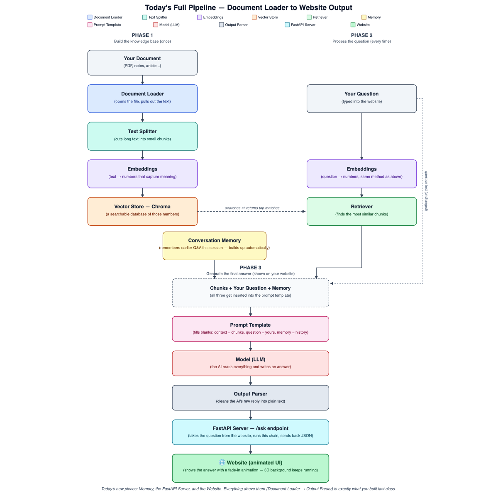

# Day 4 — Animated RAG Website (with Memory)

Quick, simple notes. Today you gave your RAG + memory chatbot a real website front-end instead of a plain terminal — same brain, new face.

## Picture: the full pipeline, start to finish

## What you need to know

| Word | Simple meaning |
|---|---|
| **FastAPI** | A Python tool for building a small web server — something that listens for requests over the network and replies. |
| **Endpoint** | One specific web address your server answers at, e.g. `/ask`. |
| **CORS** | A browser safety rule. "Enabling CORS" means telling your server "it's okay, let a webpage talk to me." |
| **POST request** | The webpage sending your question to the server and waiting for a reply. |
| **Three.js** | A JavaScript library for drawing 3D graphics in a browser — what makes an animated 3D background possible. |
| **Glassmorphism** | The blurry, see-through "frosted glass" box design style. |

**Why split frontend and backend?** The backend (Python, your RAG + memory chain) is the brain — it doesn't change. The frontend (the HTML page with animations) is the face — what a visitor actually sees and clicks. They talk to each other over a local address (`http://localhost:8000`).

## What you did, step by step

1. Wrapped your existing RAG + memory chatbot in a small web server (`server.py`) with one address, `/ask`, that answers questions.
2. Built a website (`index.html`) with an animated 3D background (Three.js) and a chat box styled like frosted glass.
3. Connected the two: typing a question on the website sends it to your server, which runs it through your real chatbot and sends the answer back.
4. Tested memory on the website — asked a follow-up question that only made sense if it remembered the earlier one.

## Pass criteria

- [ ] Wrap a LangChain chain in a FastAPI endpoint
- [ ] Build an animated, 3D-styled website that calls that endpoint
- [ ] Get a grounded, memory-aware answer to show up on the website

## Learn more

### 🎥 YouTube crash courses

**English:**
- [FastAPI Course for Beginners](https://www.youtube.com/watch?v=tLKKmouUams) — freeCodeCamp.org (~3.5 hrs; installing FastAPI, path/query params, POST requests)
- [Three.js 101 Crash Course: Beginner's Guide to 3D Web Design](https://www.youtube.com/watch?v=KM64t3pA4fs) — Zero To Mastery (watch the early sections for an animated background — you don't need the whole 7 hours)
- [LangChain Tutorial #5: Add Chat History & Memory to Your Chatbot](https://www.youtube.com/watch?v=KwA5DnRo_co) — Leon van Zyl

**Hindi:**
- [Fetch API Complete in One Video](https://www.youtube.com/watch?v=a8tsXX6nvw4) — Geeky Shows (connecting a webpage to a backend with `fetch`)
- [Generative AI Crash Course With LangChain (3 hours)](https://www.youtube.com/watch?v=7qqGnuRrWxg) — Krish Naik Hindi

*(Note: no verified Hindi-language FastAPI or Three.js video from a well-known channel was found — the Hindi videos above cover the fetch/connection and LangChain memory parts instead.)*

### 💻 GitHub reference projects

- [iremhazald/chatbot-memory-app](https://github.com/iremhazald/chatbot-memory-app) — a near-exact match for today: FastAPI + LangChain backend with memory, plain HTML/JS frontend using fetch.
- [mrdoob/three.js](https://github.com/mrdoob/three.js/) — the official Three.js repo, with an `examples/` folder full of animated scenes once you want to go beyond the tutorial.
- [eugeneyan/fastapi-html](https://github.com/eugeneyan/fastapi-html) — a minimal example of FastAPI serving a webpage.

### 🎓 Free certification

- [Front End Development — Free Course with Certificate (Simplilearn SkillUp)](https://www.simplilearn.com/front-end-developer-free-course-skillup) — completely free, 12 hours, covers HTML/CSS/JavaScript/Git, includes a certificate. (No dedicated free FastAPI course exists on Simplilearn — this is the closest fit. A narrower [free JavaScript-only course](https://www.simplilearn.com/learn-javascript-basics-free-course-skillup) is also available, ~5 hrs.)
