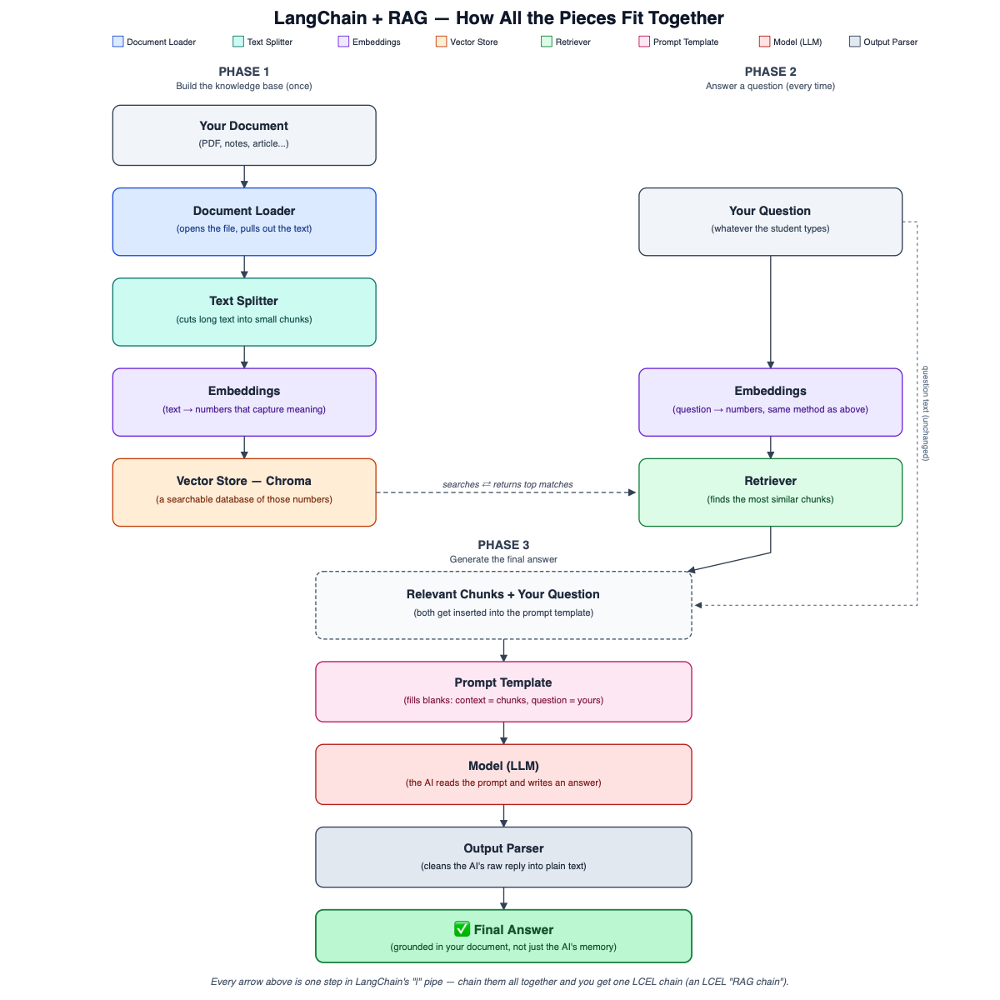

# Day 3 — LangChain & Basic RAG

Quick, simple notes. Two small projects in this folder: `chain_demo.py` / `chain_with_memory.py` (LangChain basics) and `rag/` (a full RAG app).

## Picture: how it all fits together



## Part 1 — LangChain Basics

| Word | Simple meaning |
|---|---|
| **Model** | The piece that actually talks to the AI (sends a message, gets a reply). |
| **Prompt Template** | A reusable instruction with a blank you fill in each time, e.g. `"Explain {term}"`. |
| **Output Parser** | Cleans up the AI's raw reply into the exact format you want (here: plain text). |
| **Chain (LCEL, the `\|` symbol)** | Connects steps together: *do this, then feed the result into the next step.* `prompt \| model \| parser` means "fill the prompt → send to AI → clean the reply." |
| **Memory** | Remembering earlier messages in a conversation, so the AI can understand things like "explain that again." |

**Why LangChain?** Without it, you'd hand-write all the "send a message, get a reply, remember the conversation" plumbing yourself. LangChain gives you ready-made pieces you snap together instead.

### Code walkthrough — `chain_demo.py`

```python
llm = ChatGoogleGenerativeAI(model=..., google_api_key=...)
```
This is the **Model** — the connection to the AI.

```python
prompt = ChatPromptTemplate.from_messages([
    ("system", "You explain confusing tech words in ONE simple sentence..."),
    ("user", "{term}"),
])
```
This is the **Prompt Template** — `{term}` is the blank that gets filled with whatever word you type in.

```python
parser = StrOutputParser()
```
This is the **Output Parser** — it means "give me the reply as plain text."

```python
explainer_chain = prompt | llm | parser
```
This is the **Chain** — the `|` connects all three steps into one pipeline.

### `chain_with_memory.py` adds Memory

```python
history = []
...
history.append(HumanMessage(content=term))
history.append(AIMessage(content=reply))
```
Every question and answer gets saved into a plain list. Each new question, the whole list is sent back to the AI again — that's how it "remembers" earlier turns.

## Part 2 — Basic RAG

**RAG (Retrieval-Augmented Generation):** instead of trusting the AI's own memory (which can be wrong or outdated), you first fetch real facts from your own document, then hand those facts to the AI along with the question — so the answer is grounded in something true.

| Step | Simple meaning |
|---|---|
| **Document upload** | Give the app a file (here: a PDF). |
| **Chunking** | Cut the long document into small pieces, since the AI can't usefully search one giant blob of text. |
| **Embeddings** | Turn each chunk (and the question) into numbers that capture meaning. |
| **Vector database** | A searchable database of those numbers (we use Chroma, runs locally). |
| **Retrieval** | Search the vector database for the chunks most similar to the question. |
| **Grounded answering** | Answer using ONLY the retrieved chunks — and say "not in my documents" if the answer isn't in them. |

### Code walkthrough — `rag/ingest.py` (builds the knowledge base)

```python
loader = PyPDFLoader(pdf_path)
documents = loader.load()
```
Opens the PDF, pulls out the raw text, one "document" per page.

```python
splitter = RecursiveCharacterTextSplitter(chunk_size=500, chunk_overlap=50)
chunks = splitter.split_documents(documents)
```
Cuts the text into 500-character chunks, with a 50-character overlap so sentences don't get awkwardly cut in half.

```python
embeddings = GoogleGenerativeAIEmbeddings(model="models/embedding-001", ...)
Chroma.from_documents(chunks, embeddings, persist_directory="db")
```
Turns every chunk into numbers and saves them into a local folder called `db` — this is the searchable vector database.

### Code walkthrough — `rag/ask.py` (answers questions)

```python
vector_store = Chroma(persist_directory="db", embedding_function=embeddings)
retriever = vector_store.as_retriever(search_kwargs={"k": 3})
```
Reopens the saved database and sets up a retriever that returns the top 3 most relevant chunks for any question.

```python
prompt = ChatPromptTemplate.from_template("""Answer using ONLY the context below...
If the answer is not in the context, reply with exactly: "not in my documents" ...""")
```
This single instruction is what makes the answer "grounded" — it forbids outside knowledge and gives the exact required wording for a missing answer.

```python
rag_chain = (
    {"context": retriever | format_chunks, "question": RunnablePassthrough()}
    | prompt | llm | parser
)
```
The full RAG chain: retrieve the relevant chunks → format them as text → fill the prompt (context + question) → send to the AI → clean the reply.

## How to run the RAG project

```bash
pip install -r requirements.txt
cd rag
python ingest.py your_file.pdf
python ask.py
```

## Pass criteria (what you should be able to do)

- [ ] Call a model through LangChain
- [ ] Build a `prompt | model | parser` chain
- [ ] Add conversation memory
- [ ] Build an app that follows: `upload doc → chunk → embed → store in vector DB → retrieve → answer`
- [ ] Answers must be grounded in the document, and say "not in my documents" when the answer isn't found

## Learn more

### 🎥 YouTube crash courses

**English:**
- [LangChain Crash Course for Beginners](https://www.youtube.com/watch?v=lG7Uxts9SXs) — freeCodeCamp.org
- [LangChain Crash Course For Beginners | LangChain Tutorial](https://www.youtube.com/watch?v=nAmC7SoVLd8) — codebasics
- [RAG + Langchain Python Project: Easy AI/Chat For Your Docs](https://www.youtube.com/watch?v=tcqEUSNCn8I) — pixegami (~20-30 min; closest match to this project — chunking, embeddings, Chroma, "chat with your docs")

**Hindi:**
- [Generative AI Crash Course With LangChain (3 hours)](https://www.youtube.com/watch?v=7qqGnuRrWxg) — Krish Naik Hindi
- [Building a RAG System in LangChain | Video 15](https://www.youtube.com/watch?v=J5_-l7WIO_w) — CampusX (hands-on RAG build)

### 💻 GitHub reference projects

- [pixegami/langchain-rag-tutorial](https://github.com/pixegami/langchain-rag-tutorial) — small, beginner-readable "chat with your PDF" style repo (pairs with the pixegami video above).
- [langchain-ai/rag-from-scratch](https://github.com/langchain-ai/rag-from-scratch) — official LangChain-team notebooks building up RAG step by step.
- [krishnaik06/RAG-Tutorials](https://github.com/krishnaik06/RAG-Tutorials) — companion repo to Krish Naik's RAG crash courses.

### 🎓 Free certification

- [Free Generative AI Models Course (Simplilearn SkillUp)](https://www.simplilearn.com/free-generative-ai-models-course-skillup) — completely free, includes a certificate of completion. (No LangChain-specific free course exists on Simplilearn yet — this is the closest free Gen AI basics course.)
